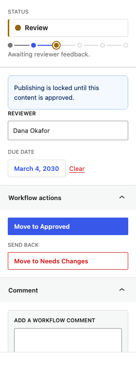
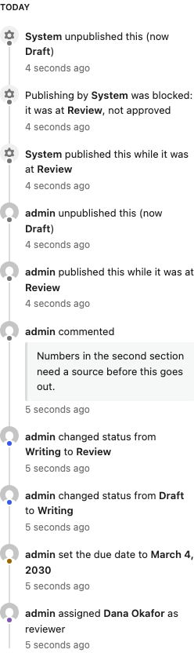
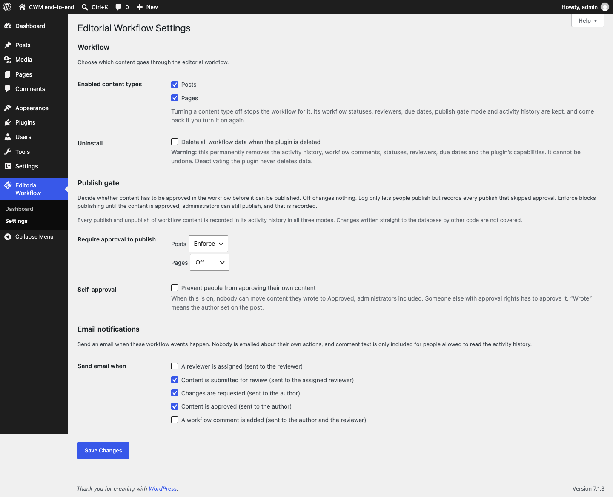
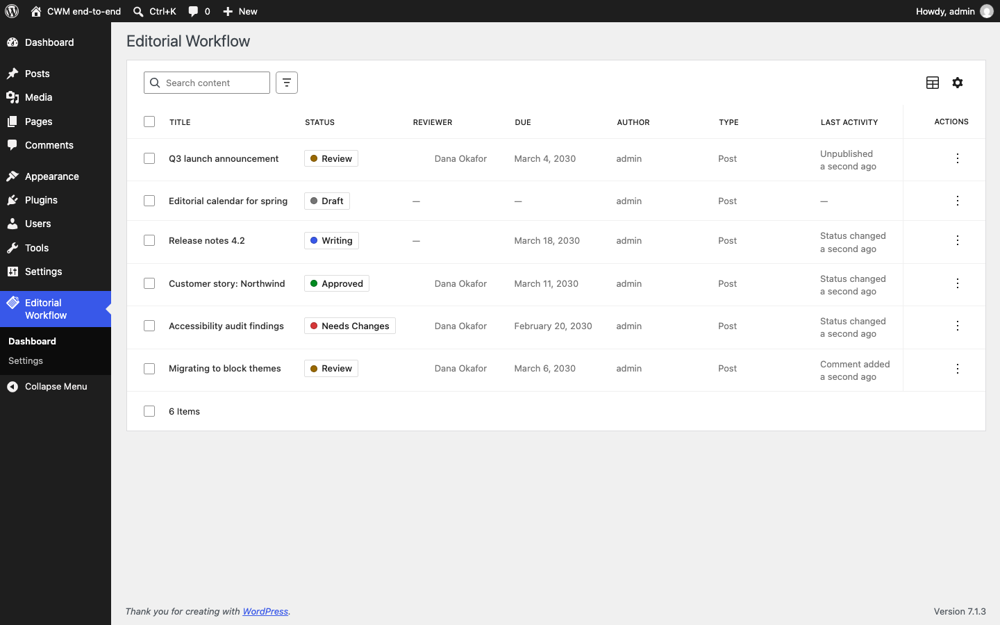
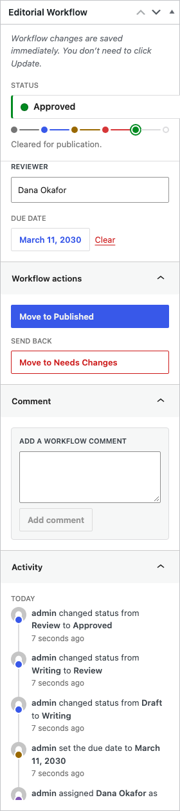
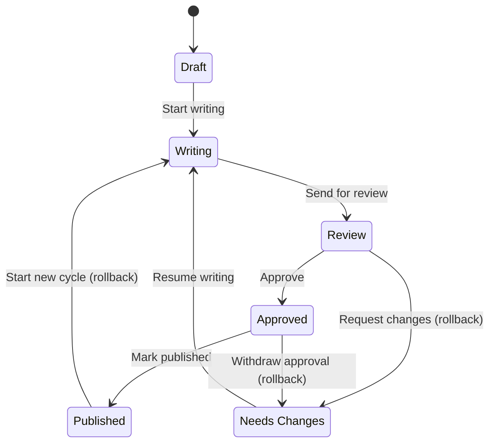

# SapphireIT Editorial Workflow

**SapphireIT Editorial Workflow** is a WordPress editorial workflow plugin for
content review and approval. It adds a separate workflow status, reviewer
assignment, due dates, editorial comments and activity history to posts, pages
and supported custom post types. Manage reviews in the Gutenberg block editor
sidebar, classic editor meta box or admin dashboard, with workflow transitions
and permissions enforced server-side.

An optional publish gate stops unapproved content from going live, and every
publication is on the record. AI can draft it. A human approves it. You can
prove who approved what, and when.



Most sites keep an article's progress in the WordPress post status and in
people's heads: who has looked at it, what still needs doing, which revision is
signed off. SapphireIT Editorial Workflow makes that process explicit. It adds a
separate editorial state to each managed post, restricts which moves are
allowed, records who changed what and when, and keeps it all visible in the
editor where the work happens.

It is built for the two audiences that share a WordPress editorial process:

- **Editorial teams** who track a piece across writers, reviewers and approvers,
  assign a reviewer, set a due date, request revisions and review what happened.
- **Developers** who need the rules enforced server-side, a documented REST API,
  a predictable data model and extension hooks.

```
React Gutenberg UI  ──►  REST API  ──►  PHP Workflow Engine
                         sit-cwm/v1     │
                                        ├─► Permissions  (PermissionManager)
                                        ├─► Transition rules (TransitionManager)
                                        ├─► WordPress data (post meta)
                                        └─► Activity log  (wp_sit_cwm_activity)
```

The arrows only point one way. The React UI never decides whether a transition
is allowed; it renders what the server told it is possible and sends the move
back for the server to re-derive from scratch. See
[ARCHITECTURE.md](ARCHITECTURE.md).

---

## At a glance

| | |
|---|---|
| **What it does** | Adds a structured editorial approval workflow to existing WordPress content: status, reviewer, due date, comments and activity history. |
| **Supported content types** | Posts, pages, and any custom post type with an admin UI, REST support and the `editor` feature that you enable in the settings. |
| **Editor interfaces** | Block (Gutenberg) editor sidebar, classic editor meta box, and an admin dashboard. |
| **Workflow statuses** | Draft, Writing, Review, Needs Changes, Approved, Published. |
| **Minimum WordPress** | 6.8 |
| **Minimum PHP** | 7.4 |
| **Tested up to** | WordPress 7.1 |
| **License** | GPL-2.0-or-later — see [LICENSE](LICENSE) |
| **Technical docs** | [ARCHITECTURE.md](ARCHITECTURE.md) · [WORKFLOW.md](WORKFLOW.md) · [REST-API.md](REST-API.md) · [DEVELOPMENT.md](DEVELOPMENT.md) · [CONTRIBUTING.md](CONTRIBUTING.md) |

---

## Screenshots

| | |
|---|---|
|  |  |
| **Editor sidebar** — the content is not approved, so the publish gate locks publishing. | **Activity timeline** — content published while it was at Review, and a publish the gate blocked. |
|  |  |
| **Settings** — the Publish gate and Email notifications sections. | **Dashboard** — every managed post, filtered and sorted server-side. |
|  | |
| **Classic editor** — the same workflow box in the classic editor. | |

See [docs/screenshots/README.md](docs/screenshots/README.md) for how these are
captured.

---

## Features

- **Publish gate, per content type.** *Off*, *Log only* or *Enforce*. In
  *Enforce*, content cannot be published or scheduled until its workflow status
  is Approved, across the block editor, the classic editor, Quick Edit, Bulk
  Edit, `wp/v2` REST, WP-CLI and scheduled publishing. Administrators can still
  publish, and that is recorded. Every type starts at *Off*. See
  [WORKFLOW.md](WORKFLOW.md#publishing-and-the-publish-gate), including what
  the gate does **not** cover.
- **Publication audit trail.** Every publish and unpublish of managed content is
  logged with the actor, the time and the workflow status at that moment, in
  every gate mode including *Off*.
- **Opt-in email notifications** for five events: reviewer assigned, submitted
  for review, changes requested, approved, workflow comment added. Off until a
  site owner turns them on; never sent to the actor or to anyone who cannot
  read the post.
- **Six-status editorial workflow** — Draft, Writing, Review, Needs Changes,
  Approved and Published, with a fixed transition graph and explicit rollback
  paths. The statuses are not a single line: Review can approve or send back, an
  approval can be withdrawn, and Published content can start a new cycle. See
  [Workflow overview](#workflow-overview) and [WORKFLOW.md](WORKFLOW.md).
- **Server-side transition validation.** Every move is re-checked against the
  transition map, the capability map and the post's *current* stored status. A
  client that posts `{"status": "approved"}` gets the same answer as one that
  clicks the button.
- **Optimistic concurrency.** A status change must state the status the client
  believed was current; if someone else moved the post meanwhile the request
  fails with `409` instead of silently overwriting.
- **Seven dedicated capabilities** (`sit_cwm_*`), granted to roles at
  activation. No role names are hard-coded anywhere else in the plugin.
- **Reviewer assignment and due dates**, with an *Overdue only* filter computed
  in the site timezone.
- **Workflow comments** stored alongside the audit trail, not in `wp_comments`.
- **Activity history** in a dedicated indexed table, never a growing serialized
  meta array.
- **Gutenberg editor sidebar** — status, reviewer, due date, transition buttons
  and the timeline, without leaving the editor.
- **Classic editor meta box** — the same panel in an *Editorial Workflow* box
  for sites and post types (e.g. WooCommerce products) that use the classic
  editor. Changes save immediately through REST, independently of **Update**.
- **Admin dashboard** built on `@wordpress/dataviews`: server-side search,
  filtering, sorting and pagination, row actions and bulk actions over up to
  100 posts per request.
- **A real REST API.** Everything the UI does is a documented, authenticated
  endpoint — see [REST API](#rest-api) and [REST-API.md](REST-API.md) for `curl`
  examples.

---

## Workflow overview

Every managed post starts at **Draft**. The workflow status is stored in post
meta (`_sit_cwm_status`) and is separate from the WordPress post status.

### What each status means

| Status | Meaning |
|---|---|
| **Draft** | Not yet started in the workflow. The default for every managed post. |
| **Writing** | The author is working on the content. |
| **Review** | Awaiting reviewer feedback. |
| **Needs Changes** | Sent back to the author for changes. |
| **Approved** | Cleared for publication. |
| **Published** | Published; the workflow cycle is complete. |

### The transition graph

Not every move is legal. The graph is fixed in the core plugin and filterable
through `sit_cwm_transition_map`.



Read as a table:

| From | May move to |
|---|---|
| `draft` | `writing` |
| `writing` | `review` |
| `review` | `approved`, `needs_changes` |
| `needs_changes` | `writing` |
| `approved` | `published`, `needs_changes` |
| `published` | `writing` |

Rules that hold for every edge:

- **No self-transitions.** `writing → writing` is invalid, not a no-op.
- **Any pair not in the table is invalid**, whatever capabilities the user
  holds. An administrator cannot jump `draft → approved`.
- **The graph is data, not code.** `sit_cwm_transition_map` can replace it; the
  result is validated against the status registry, so a filter cannot introduce
  an unknown status or a self-transition.

### The normal path and the loops

- **Normal editorial path:** `draft → writing → review → approved → published`.
- **Revision loop:** from `review`, a reviewer either approves or sends the post
  back to `needs_changes`; the author then resumes `writing` and resubmits for
  `review`.
- **Approval withdrawn:** `approved → needs_changes` exists so withdrawing an
  approval does not require a trip back through `review`.
- **Re-review of live content:** `published → writing` starts a fresh cycle
  while the WordPress post stays published.

Three edges send content *backwards* — `review → needs_changes`,
`approved → needs_changes` and `published → writing`. They are flagged
separately (`sit_cwm_rollback_transitions`) so the UI styles them as destructive
and asks for confirmation.

### Workflow status is not WordPress post status

These are two independent fields that are allowed to disagree. The workflow
status lives in `_sit_cwm_status`; the WordPress post status lives in
`wp_posts.post_status`, and the workflow never writes to it. (The optional
publish gate can only *stop* a publish; it never publishes.)

As a consequence, **reaching the `published` workflow status does not publish
the post.** A human still clicks *Publish*. Keeping the fields apart is what
lets a scheduled post keep its schedule while it is being approved, and lets an
already-live article go back through a round of edits without being unpublished.
The full rationale is in
[ARCHITECTURE.md](ARCHITECTURE.md#why-workflow-status-is-not-wordpress-post-status).

Moving a post to the `published` workflow status therefore requires **both**
`sit_cwm_approve_content` — the capability mapped to the target status — and
WordPress' own `publish_post` on that specific post, so the workflow step does
not grant a publishing ability the user would not otherwise have.

---

## What it deliberately does *not* do

Being honest about this is part of the design:

- **No automatic publishing.** Reaching the `published` workflow status does
  **not** publish the post — that stays a deliberate editor action. Workflow
  status and WordPress post status are separate fields on purpose
  ([why](ARCHITECTURE.md#why-workflow-status-is-not-wordpress-post-status)).
  The publish gate only ever *prevents* publishing; it never publishes.
- **No AI detection.** It records who approved content, not who or what wrote
  it.
- **No guard against direct database writes.** Code that updates
  `wp_posts.post_status` through `$wpdb` is not seen by the publish gate
  ([uncovered paths](WORKFLOW.md#what-the-gate-does-not-cover)).
- **No Slack, no calendar, no rules engine, no multiple workflows.** Those are
  named in the [roadmap](#roadmap), not shipped.

None of these are hidden behind an upsell in this plugin.

---

## Requirements

| | |
|---|---|
| WordPress | 6.8 or newer |
| PHP | 7.4 or newer |
| Tested up to | WordPress 7.1 |

The plugin loads no PHP 7.4+ syntax before checking `PHP_VERSION`, so on an
older PHP it shows an admin notice instead of fataling.

There are no runtime PHP dependencies and no external services. The plugin makes
no remote requests, loads nothing from a CDN, sets no cookies of its own and
collects no usage data.

---

## Installation

### From a release zip

1. Download the `sapphireit-editorial-workflow.zip` release package.
2. **Plugins → Add New → Upload Plugin**, choose the zip, install, activate.

Activation creates the `wp_sit_cwm_activity` table and grants the workflow
capabilities to the administrator, editor, author and contributor roles.

### From a clone

`assets/build/` is committed, so a clone runs as-is — no build step needed:

```sh
git clone <repository-url> sapphireit-editorial-workflow
# into wp-content/plugins/, then activate in wp-admin
```

Composer and npm are only needed for development. The plugin ships a fallback
autoloader for when `vendor/` is absent, and the compiled JavaScript in
`assets/build/` means you do not need to run a build to use it. Do not activate
an unbuilt development checkout whose `src/` changes have not been compiled.

---

## Quick start

1. Activate the plugin.
2. **Editorial Workflow → Settings** — choose which post types the workflow
   applies to (default: posts and pages).
3. Open a post in the block editor and click the **Editorial Workflow** icon in
   the top-right toolbar. Every managed post starts at **Draft**. In the classic
   editor, the same controls appear in the **Editorial Workflow** box in the
   sidebar column.
4. Move it along: **Draft → Writing** when you start, **Writing → Review** when
   it is ready, and assign a reviewer plus a due date if you are allowed to.
5. The reviewer either **Approves** it or sends it back with **Needs Changes**,
   leaving a workflow comment explaining why.
6. **Editorial Workflow → Dashboard** shows everything in flight, with search,
   filtering, sorting, row actions and bulk actions.
7. Optional: under **Settings → Publish gate**, set a content type to *Enforce*
   so it cannot be published until it is Approved, and tick the events you want
   under **Email notifications**.

---

## Status and permission reference

### The six capabilities

| Capability | Grants |
|---|---|
| `sit_cwm_change_workflow` | Move content through the author-side statuses (Draft, Writing, Review). |
| `sit_cwm_review_content` | Send content back to **Needs Changes**; also the capability a user must hold to be assignable as a reviewer. |
| `sit_cwm_approve_content` | Reach **Approved** and **Published**. |
| `sit_cwm_assign_reviewer` | Set or clear the reviewer **and** the due date. |
| `sit_cwm_view_activity` | Read the activity timeline and workflow comments. |
| `sit_cwm_manage_workflows` | The settings page, and attempting bulk actions. |

### Reaching each status

| Status | Meaning | Required capability |
|---|---|---|
| **Draft** | Not yet started in the workflow. The default. | `sit_cwm_change_workflow` |
| **Writing** | The author is working on it. | `sit_cwm_change_workflow` |
| **Review** | Awaiting reviewer feedback. | `sit_cwm_change_workflow` |
| **Needs Changes** | Sent back to the author. | `sit_cwm_review_content` |
| **Approved** | Cleared for publication. | `sit_cwm_approve_content` |
| **Published** | The cycle is complete. | `sit_cwm_approve_content` **+** WordPress `publish_post` |

The capability is keyed to the **target** status, not to the edge. Moving
`approved → needs_changes` needs `sit_cwm_review_content`, the same as
`review → needs_changes`, because both land on `needs_changes`.

On top of the capability, every move also requires WordPress' own `edit_post` on
that specific post, and a post type the workflow is enabled for. The last word
on a permission decision is the `sit_cwm_can_transition` filter, which runs
after the capability checks.

### Workflow capabilities vs. WordPress post permissions

The workflow capabilities and WordPress' own post permissions are different
things, and both apply:

- Workflow capabilities (`sit_cwm_*`) decide which *statuses* a user may reach.
- WordPress' post-specific permissions (`edit_post`, `publish_post`,
  `read_post`) decide what a user may do to *that particular post*. They are
  checked with the post's ID, so a contributor who holds
  `sit_cwm_change_workflow` still only reaches their own unpublished posts, and
  an author cannot `publish_post` on someone else's post whatever
  `sit_cwm_approve_content` says.

### Default role grants

Grants are applied at activation and are ordinary role capabilities — any
capability-management plugin can change them. Roles not listed (for example
subscriber) receive nothing.

| Role | Capabilities granted at activation |
|---|---|
| Administrator | all seven |
| Editor | `change_workflow`, `assign_reviewer`, `review_content`, `approve_content`, `view_activity` |
| Author | `change_workflow`, `view_activity` |
| Contributor | `change_workflow`, `view_activity` |
| Subscriber | none |

The other three capabilities are `sit_cwm_assign_reviewer` (set or clear the
reviewer and due date), `sit_cwm_manage_workflows` (settings page, bulk
actions) and `sit_cwm_bypass_publish_gate` (publish unapproved content while the
gate is set to *Enforce*; administrators only, and every use is recorded).
Grants are ordinary role capabilities — any capability-management plugin can
change them.

Grants are made on the current site at activation. A network-wide activation
sets up every site, and a site created afterwards is set up on
`wp_initialize_site`. Permissions themselves are checked dynamically on every
request; the grants only seed the default roles.

### Who can be a reviewer

Only a user who holds `sit_cwm_review_content`. Assigning anyone else fails with
`sit_cwm_invalid_user` (400), single or bulk. With the default grants that means
editors and administrators.

---

## Architecture summary

```
includes/
  Core/       Plugin, Container, Activator/Deactivator, Database, Settings, Assets
  Workflow/   WorkflowManager, StatusManager, TransitionManager,
              PermissionManager, Capabilities, BulkProcessor
  Content/    PostMeta, PostRepository
  Activity/   ActivityLogger, ActivityEntry
  Publishing/ PublishGate, the three gate layers, PublicationLogger
  Notifications/ Notifier, RecipientResolver, MessageBuilder
  REST/       Workflow / Activity / Posts / Batch / User controllers
  Editor/     SidebarAssets, ClassicMetaBox
admin/        Dashboard, Settings
src/          React source (sidebar, classic meta box, dashboard)
assets/build/ compiled output (committed)
```

Three rules hold the design together:

1. **`WorkflowManager` is the only way to change workflow state.** REST
   controllers, bulk actions and the React app are thin clients over it.
2. **`TransitionManager` answers "is this edge in the graph?"; `PermissionManager`
   answers "may this user do it?".** Neither knows about the other.
   `WorkflowManager` is the only place they meet, so neither can be bypassed
   through the other.
3. **Workflow status is not WordPress post status.** They are separate fields
   that never write to each other.

The UI never decides whether a transition is allowed: the sidebar renders the
`available_transitions` the server computed for that user and post, and every
mutating request re-derives the same answer before writing. A hostile client
with a valid cookie and nonce can do exactly what the UI lets an honest one do,
and nothing more.

Full detail — the `transition()` pipeline, the data model, the concurrency guard
and the known trade-offs — is in [ARCHITECTURE.md](ARCHITECTURE.md).

---

## REST API

Everything the Gutenberg sidebar and the admin dashboard do goes through the
plugin's own REST API under the **`sit-cwm/v1`** namespace. There is no private
AJAX action and no hidden path: the React app is a client of this API, and so
can you be. The eight endpoints are documented with `curl` examples in
[REST-API.md](REST-API.md).

| Method | Route | Purpose |
|---|---|---|
| `GET` | `/posts/{post_id}/workflow` | One post's workflow state and what this user may do next |
| `POST` | `/posts/{post_id}/workflow` | Change status, reviewer and/or due date |
| `GET` | `/posts/{post_id}/activity` | Paginated activity history |
| `POST` | `/posts/{post_id}/comments` | Add a workflow comment |
| `GET` | `/statuses` | Status registry and transition map |
| `GET` | `/posts` | Dashboard collection |
| `POST` | `/posts/batch` | Bulk status / reviewer / due date |
| `GET` | `/users` | Assignable reviewers |

**Authentication and authorization are separate.** The plugin's own UI
authenticates with the logged-in session cookie and the `wp_rest` nonce, sent by
`@wordpress/api-fetch`. External clients (`curl`, scripts, CI) use a WordPress
[application password](https://wordpress.org/documentation/article/application-passwords/)
over HTTP Basic auth. Authentication only identifies the user; every route then
has a real `permission_callback` that re-derives authorization server-side —
there is no `__return_true` anywhere in the plugin. The `capabilities` and
`available_transitions` a response returns are display hints, never a grant.

One deliberate detail: a post that is missing, has no workflow, **or** is not
readable by the caller returns the identical `sit_cwm_not_managed` (404), so a
`403` is only ever returned for a post the caller can already see. This prevents
the error codes from enumerating private post IDs.

---

## Extensibility

Free core fires these so add-ons (and your own code) can extend it without
touching a core file. Every one is prefixed `sit_cwm_`.

### Actions

| Hook | Signature | Fires |
|---|---|---|
| `sit_cwm_status_changed` | `( int $post_id, string $from, string $to, int $user_id )` | After a status change is persisted and logged. |
| `sit_cwm_reviewer_assigned` | `( int $post_id, int $reviewer_id, int $previous_id, int $user_id )` | After the reviewer changes. `$reviewer_id === 0` means cleared; `$user_id === 0` means the system did it, which is how a deleted user's assignments are cleaned up. |
| `sit_cwm_due_date_changed` | `( int $post_id, string $date, string $previous, int $user_id )` | After the due date changes. `''` means cleared. |
| `sit_cwm_comment_added` | `( int $post_id, int $activity_id, string $message, int $user_id )` | After a workflow comment is stored. |
| `sit_cwm_activity_logged` | `( int $activity_id, ActivityEntry $entry )` | After any activity row is written. |
| `sit_cwm_db_upgraded` | `( string $from_version, string $to_version )` | After the schema is migrated. |
| `sit_cwm_publish_gate_refused` | `( int $post_id, GateDecision $decision, int $user_id, string $layer )` | After the publish gate refuses a publish and the refusal is recorded. |
| `sit_cwm_publish_gate_bypassed` | `( int $post_id, GateDecision $decision, int $user_id, string $layer )` | After unapproved content goes live in *Log only*, or under the bypass capability in *Enforce*. |
| `sit_cwm_publish_gate_failed` | `( string $layer, Throwable $error, int $post_id )` | A gate layer threw; the publish went ahead (the gate fails open). |
| `sit_cwm_notification_sent` | `( string $event, int $post_id, int $recipient_id, bool $sent )` | After each `wp_mail()` call; `$sent` is its return value. |

### Filters

| Hook | Signature | Controls |
|---|---|---|
| `sit_cwm_statuses` | `( array $statuses )` | The status registry. Entries need `slug` + `label`; invalid ones are dropped and the `draft` default must survive. |
| `sit_cwm_transition_map` | `( array $map )` | The transition graph, as `from => [ to, … ]`. Unknown statuses and self-transitions are stripped. |
| `sit_cwm_rollback_transitions` | `( array $rollbacks )` | Which of those edges count as "sending content back", for UI styling. |
| `sit_cwm_status_capability_map` | `( array $map )` | Target status → required capability. |
| `sit_cwm_can_transition` | `( bool $allowed, int $post_id, string $from, string $to, int $user_id )` | **The last word on a permission decision.** Runs after the capability checks; only boolean `true` allows. |
| `sit_cwm_available_transitions` | `( array $transitions, int $post_id, string $from, int $user_id )` | The UI's button list. May remove, reorder or relabel — never add a move the user was not already allowed. |
| `sit_cwm_enabled_post_types` | `( string[] $post_types )` | Which post types have a workflow. |
| `sit_cwm_available_post_types` | `( array $post_types )` | Which post types the settings screen offers (slug => slug). Defaults to types with an admin UI, REST support and the `editor` feature; internal types are always removed. |
| `sit_cwm_activity_actions` | `( string[] $actions )` | Loggable action slugs. |
| `sit_cwm_activity_action_labels` | `( array $labels )` | Human-readable labels for those slugs. |
| `sit_cwm_assignable_reviewers` | `( array $query, int $post_id, int $user_id )` | `get_users()` arguments behind `GET /users`. `fields` and `count_total` are re-forced afterwards. |
| `sit_cwm_publish_gate_mode` | `( string $mode, string $post_type, int $post_id )` | A post type's gate mode. `$post_id` is `0` when the question is not about one post. A value outside `off`/`log_only`/`enforce` means `off`. |
| `sit_cwm_publish_gate_passes` | `( bool $passes, int $post_id, string $workflow_status, string $mode )` | Whether a publish attempt passes the gate. Only boolean `true` passes; `false` and a `WP_Error` both refuse. |
| `sit_cwm_notification_recipients` | `( int[] $user_ids, string $event, int $post_id, int $actor_id )` | Who gets mail for an event. The actor, users without a valid email and users who cannot read the post are removed *after* this filter. |
| `sit_cwm_notification_message` | `( array $message, string $event, int $post_id, int $recipient_id )` | The `subject` and plain-text `body` of one mail, already in the recipient's language. |

`sit_cwm_can_transition` cannot grant a logged-out user, a missing post or a
post whose type has no workflow — those are hard gates checked before it runs.
It also cannot widen the transition *graph*; that is `sit_cwm_transition_map`.

```php
// Only let the assigned reviewer approve.
add_filter(
	'sit_cwm_can_transition',
	function ( $allowed, $post_id, $from, $to, $user_id ) {
		if ( 'approved' !== $to ) {
			return $allowed;
		}

		return $allowed && (int) get_post_meta( $post_id, '_sit_cwm_reviewer_id', true ) === $user_id;
	},
	10,
	5
);
```

```php
// Notify Slack when something is approved.
add_action(
	'sit_cwm_status_changed',
	function ( $post_id, $from, $to, $user_id ) {
		if ( 'approved' === $to ) {
			my_slack_notify( $post_id, $user_id );
		}
	},
	10,
	4
);
```

---

## Development

```sh
composer install
npm ci
npm run build
npm run env:start        # wp-env (Docker)
```

Then run the suites:

```sh
composer lint            # phpcs, WordPress-Extra, zero errors required
composer test            # PHP unit (no WordPress)
composer test:setup && composer test:integration
npm run test:unit        # Jest
npm run test:e2e         # Playwright
```

`assets/build/` is committed, so run `npm run build` and commit the output
alongside any `src/` change.

[DEVELOPMENT.md](DEVELOPMENT.md) covers the Docker-free setup, the build
pipeline, the performance budgets and the release process.
[CONTRIBUTING.md](CONTRIBUTING.md) covers the coding standards and what a PR
needs to be mergeable.

---

## Roadmap

Named because they are planned, not because they exist. These are deliberately
**not** in Free core — but the hooks above are the surface they attach to.

- Multiple workflows, and per-role workflow configuration
- Slack integration
- Editorial calendar
- Checklist gating before approval
- A workflow rules engine (if/then automation)
- Scheduled publishing driven by the `approved` status
- Advanced audit logs and exports

---

## License

GPL-2.0-or-later. See [LICENSE](LICENSE).

Copyright © 2026 SapphireIT.
