# SapphireIT Editorial Workflow: step-by-step guide

SapphireIT Editorial Workflow adds an approval step to WordPress. A post moves
through workflow statuses, a reviewer signs it off, and with the publish gate on,
nothing goes live until it is approved.

This guide follows one post from start to finish. It uses three people:

- **Sam Rivera**, an author, who writes the post.
- **Dana Okafor**, an editor, who reviews it.
- **Alex Chen**, an editor and the managing editor, who assigns the review and publishes.

An administrator sets everything up. Each section matches one chapter of the
tutorial video.

**Status at a glance:** Draft → Writing → Review → Needs Changes → Approved → Published

## Who can do what

These are the default permissions. Each one is a WordPress capability, so a
role editor plugin can change who has it.

| Role | Move to Draft, Writing, Review | Move to Needs Changes | Move to Approved, Published | Assign reviewer and due date | See activity and comment | Change settings |
|---|---|---|---|---|---|---|
| **Author** (Sam) | ✅ own posts | ❌ | ❌ | ❌ | ✅ | ❌ |
| **Reviewer** (Dana, an editor) | ✅ | ✅ | ✅ | ✅ | ✅ | ❌ |
| **Editor** (Alex) | ✅ | ✅ | ✅ | ✅ | ✅ | ❌ |
| **Administrator** | ✅ | ✅ | ✅ | ✅ | ✅ | ✅ |
| Capability | `sit_cwm_change_workflow` | `sit_cwm_review_content` | `sit_cwm_approve_content` | `sit_cwm_assign_reviewer` | `sit_cwm_view_activity` | `sit_cwm_manage_workflows` |

A reviewer is anyone who holds `sit_cwm_review_content`, which by default
means editors and administrators. Moving a post to Published also needs
WordPress's own permission to publish that post. [WORKFLOW.md](../../WORKFLOW.md)
has the full rules.

## 1. Set up the workflow

*Done by an administrator.*

1. Go to **Editorial Workflow → Getting Started**. This page lists the setup
   steps and links to help.

   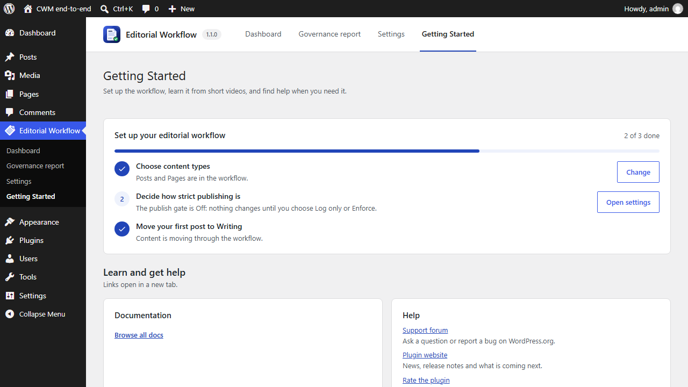

2. Go to **Editorial Workflow → Settings** and open the **Workflow** tab.
   Under **Enabled content types**, tick each type that should go through the
   workflow. Posts and Pages are ticked by default.
3. Tick **Prevent people from approving their own content**. With this on,
   someone other than the author has to approve each post. This applies to
   administrators too.

   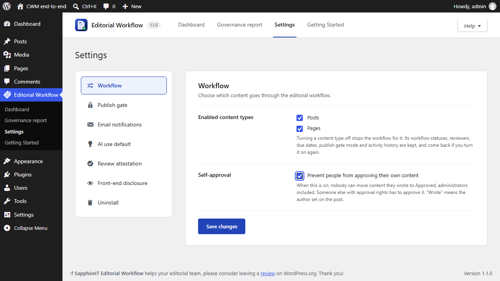

4. Open the **Publish gate** tab and set **Posts** to **Enforce**. On
   Enforce, a post cannot be published until it is approved. **Log only**
   lets people publish but records every publish that skipped approval.
   **Off** changes nothing.
5. Click **Save changes**.

   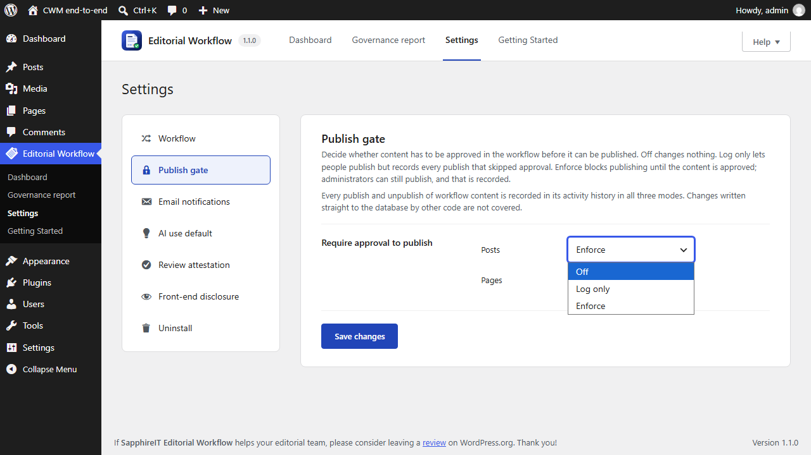

6. Open the **Email notifications** tab and tick the events that should send
   email: a reviewer is assigned, content is submitted for review, changes are
   requested, content is approved, and a comment is added. Nobody gets an email
   about their own actions.
7. Click **Save changes**.

   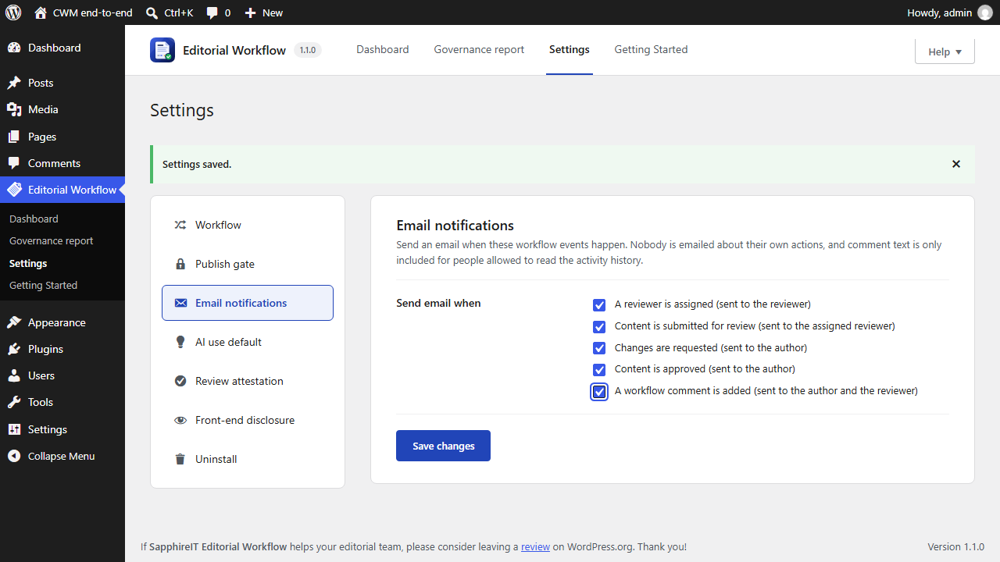

## 2. Write and submit for review

*Sam writes, Alex assigns the review, then Sam submits.*

1. Sam creates a post in the block editor, adds a title and some text, and
   clicks **Save draft**.
2. Sam opens the **Editorial Workflow** panel from the editor's top bar. The
   post is at **Draft**. The panel also says that publishing is locked until the
   post is approved, because the gate is on Enforce.
3. Sam clicks **Move to Writing**.

   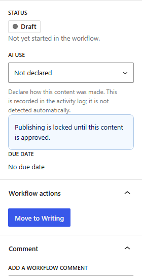

4. Alex opens the same post. In the panel, Alex picks **Dana Okafor** under
   **Reviewer**. Then Alex clicks the due date, which shows **No due date** at
   first, and picks a day in the calendar.

   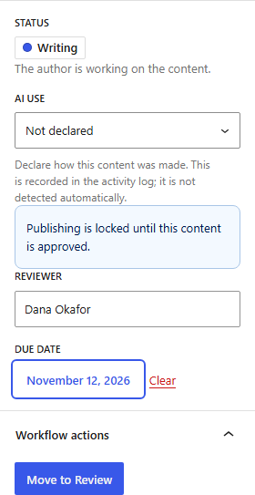

5. When the draft is ready, Sam clicks **Move to Review**. Dana gets an email
   that the post is waiting for review. Authors cannot approve, so Sam has no
   more workflow actions for now.

   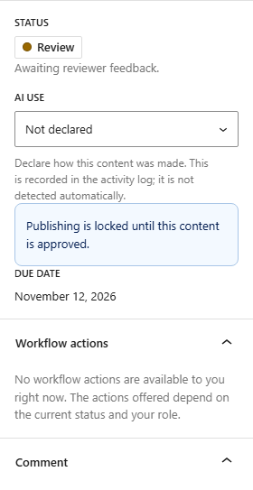

## 3. Review, approve and publish

*Dana reviews, Sam revises, Dana approves, Alex publishes.*

1. Dana opens the post. It is at **Review**, and publishing is locked until
   it is approved.

   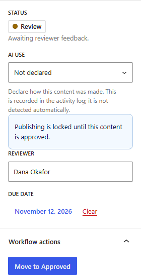

2. Dana clicks **Move to Needs Changes** and confirms. Dana types what needs to
   change under **Add a workflow comment** and clicks **Add comment**. The
   comment shows in the activity history, and Sam gets an email about it.

   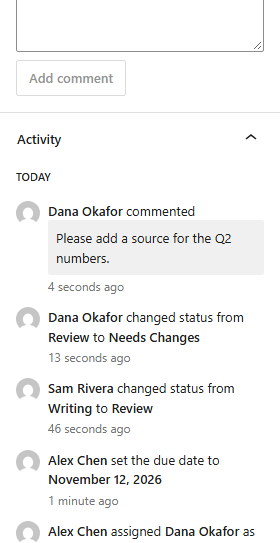

3. Sam makes the change, clicks **Move to Writing**, then **Move to Review**.
4. Dana opens the post again, clicks **Move to Approved** and confirms with
   **Approve**. The publishing lock is gone.

   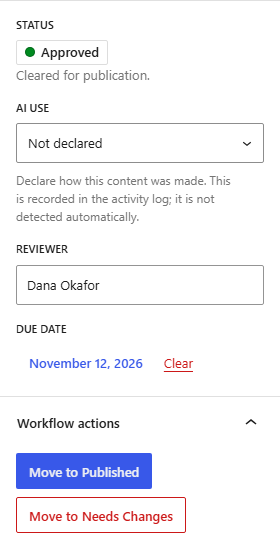

5. Alex opens the post and clicks WordPress's **Publish** button, then
   **Publish** again in the pre-publish panel. The gate lets it through because
   the post is approved.
6. Alex clicks **Move to Published** in the Editorial Workflow panel and
   confirms with **Publish**.

   Publishing the post and closing the workflow are two separate steps.
   WordPress tracks whether the post is live. The workflow status tracks where it
   is in your editorial process. The plugin keeps the two apart, so you can
   always see both.

7. The **Activity** section lists every step: who changed the status, who
   commented, who published and at which status.

   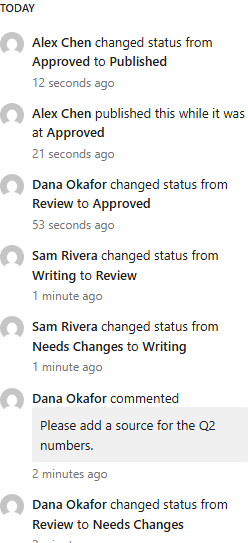

## 4. Track work on the dashboard

*Anyone who can see workflow activity can use the dashboard. The governance
report is for administrators.*

1. Go to **Editorial Workflow → Dashboard**. The tiles at the top count what is
   in review, waiting on the author, overdue, and approved but not yet
   published. The table lists every post in the workflow.
2. Click the **Due** column header and choose **Sort ascending** to see what is
   due soonest.

   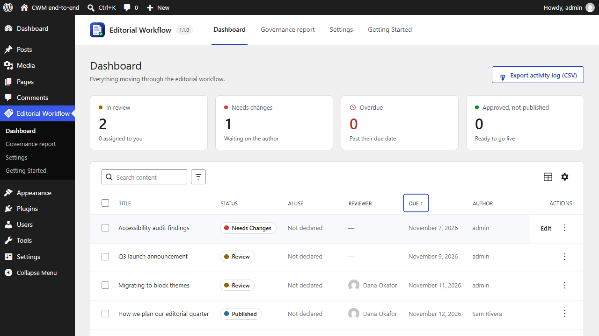

3. Click **Add filter**, choose **Status**, then **Review**. Only the posts
   waiting for review are left.

   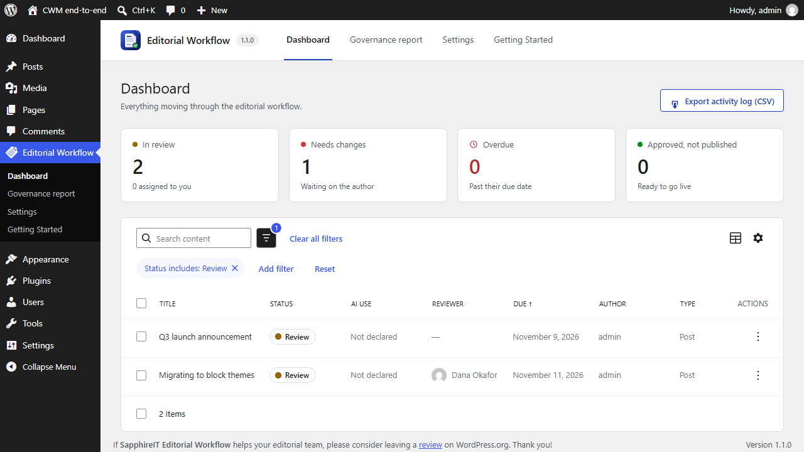

4. Type in **Search content** to find a post by its title, then click the title
   to open it in the editor.
5. As an administrator, go to **Editorial Workflow → Governance report**.
   Like Settings, it needs `sit_cwm_manage_workflows`. It shows what share of
   publications were approved first, how many went out while the gate was off or
   on Log only, how many were blocked, and how AI use was declared. Choose the
   period at the top.

   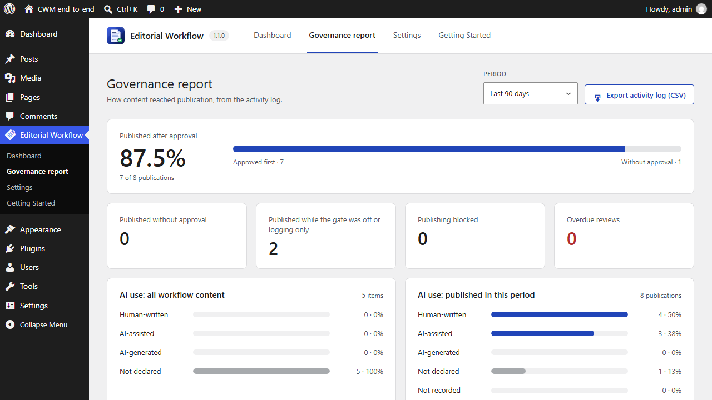

## 5. Declare AI use and confirm review

*An administrator turns on attestation, then Dana approves a post.*

1. In **Settings**, open the **Review attestation** tab, tick **Require
   approvers to confirm they reviewed the content**, and click **Save changes**.
2. Dana opens a post at Review. Under **AI use**, Dana picks how the post was
   made, here **AI-assisted**. This is a declaration that is saved in the
   activity log. The plugin does not detect AI use itself.

   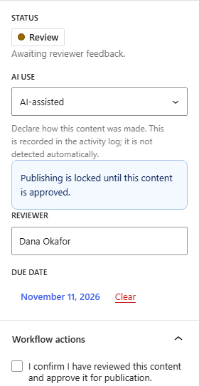

3. **Move to Approved** stays disabled until Dana ticks **I confirm I have
   reviewed this content and approve it for publication.** Dana ticks it, clicks
   **Move to Approved**, and confirms. The confirmation is saved with the
   approval.

   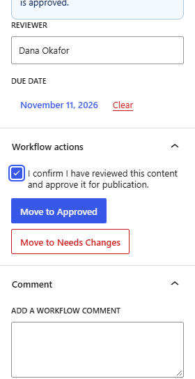
